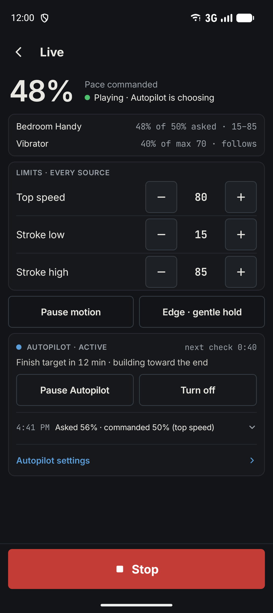
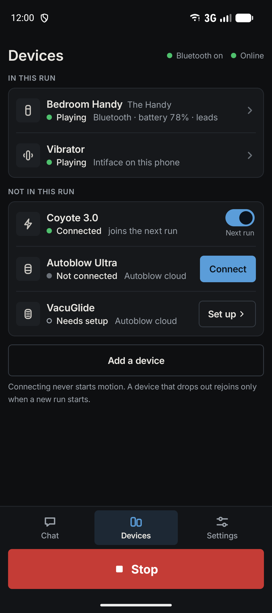
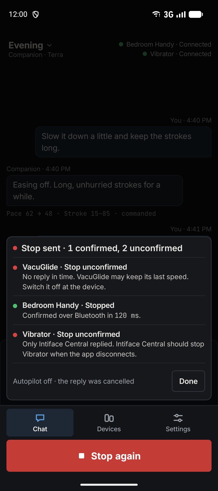

# MagicHandy Mobile

Talk to an AI companion that sets the pace, or let Autopilot run the session, with **Stop always one tap away**. MagicHandy Mobile brings the chat and device control of the [MagicHandy](https://github.com/MagicHandy/MagicHandy) desktop app to your Android phone.

  

| Chat | Live | Devices | Stop |
|:---:|:---:|:---:|:---:|
|  |  |  |  |

> [!IMPORTANT]
> **For adults only.** MagicHandy Mobile controls intimate devices.
>
> **Not released yet.** The app is in early development. Today it runs only as a developer build, with simulated devices. There's nothing to download yet.

## What you can do

- **Chat with a companion.** Pick a persona and talk. With a motion mode on, replies can set the pace within your limits; choose Off to just talk.
- **Hand the session to Autopilot.** It changes things on its own. You choose how often, whether it checks in with you (Off, Talk, or Talk and adjust), and an optional finish target, such as "build to the end over twenty minutes". Saying it in the chat works too.
- **Stay in control on Live.** See the pace being sent, set the top speed and stroke limits that every source has to respect, pause motion, or hold at the edge.
- **Use more than one device.** Run several devices together. A device you connect mid-session joins the next run, never the current one.
- **Choose a look.** Steel Azure, Lowlight (true black, for the dark) or High Contrast.

## Safety comes first

- **Stop is always one tap away.** A red Stop bar sits at the bottom of every screen, and stays just above the keyboard while you type. Typing "stop" in the chat works too, and TalkBack offers a "Stop all motion" action on any screen.
- **Stop works outside the app too.** While a device is connected, its notification has a Stop button, on the lock screen as well, and you can add a Stop tile to Quick Settings.
- **Stop reaches every device at once, and tells you what happened.** You see, device by device, whether Stop was confirmed. If a device couldn't confirm it, the app says so, and tells you what to check.
- **Nothing starts on its own.** Connecting a device never starts motion. If the app is closed mid-session, it never restarts motion or Autopilot when you reopen it. Instead, it shows what's known and what to check.
- **You rehearse Stop first.** On first launch, you confirm you're an adult and try Stop with nothing connected.

## Supported devices

| Device | Connects through | If the phone loses it |
|---|---|---|
| **The Handy**, one or several | Bluetooth, or the Handy Cloud | It pauses on its own when its motion buffer runs out. |
| **Vibrators** | [Intiface Central](https://intiface.com/central/), running on the phone or on your network | Intiface Central should stop it when the app disconnects. |
| **DG-LAB Coyote 3.0** | Bluetooth, after you read its safety notes | It goes silent when the pulses stop. |
| **Autoblow Ultra** | The Autoblow cloud | It finishes its last move, then stops. |
| **VacuGlide** | The Autoblow cloud | It may keep its last speed: switch it off at the device. |

> [!WARNING]
> **A VacuGlide can keep running after the phone loses it.** So the app sends Stop the moment the connection drops and again when it returns. It also checks in every 15 minutes by default, and if no one answers within a minute, the whole run stops.

## AI models

Connect the model you want to use:

- **ChatGPT:** sign in with your ChatGPT account.
- **OpenRouter:** add your OpenRouter API key.
- **Your own server:** Ollama, llama.cpp or another OpenAI-compatible server on your local network, added by its address.

The model runs with that provider or on your server, not on the phone. Each connection has a capability level (Simple, Intermediate or Advanced) that matches what the model can handle; for your own server, the app suggests one from the model's name.

## Privacy

- **Your data stays on your phone.** Chats, memory and settings are stored on the device and left out of Android backups.
- **Keys and sign-ins are sealed.** The Handy's connection key, Autoblow tokens, your OpenRouter key and ChatGPT sign-in tokens are encrypted with a key in Android's Keystore, and are never logged or exported.
- **No account and no analytics.** Diagnostics are redacted, and leave the phone only if you share them.
- **Your messages go only to the model you connect.**
- **The lock screen stays discreet.** It shows only "MagicHandy · Active" and Stop; the details appear after you unlock.
- **Memory is off until you turn it on.** You can delete all chats and memory in App settings.

## Requirements

- Android 12 or later.
- A supported device. The Handy over Bluetooth and the Coyote also need Bluetooth on the phone.
- A model connection: a ChatGPT account, an OpenRouter key or your own server.

The app is in English for now. Spanish, Brazilian Portuguese, Japanese and Simplified Chinese are planned for v1.

## Getting the app

There's no release yet. When v1 is ready, signed APKs and their SHA-256 checksums will be published on [GitHub Releases](https://github.com/MagicHandy/MagicHandy-Mobile/releases). The app checks for updates only when you ask it to, in App settings.

## For developers

The [developer guide](docs/README.md) covers the architecture, the current status, building and running the app, and the rules for contributing. Coding agents start with [AGENTS.md](AGENTS.md).

## License

MagicHandy Mobile is licensed under GPL-3.0-only ([LICENSE](LICENSE)), because it derives from the MagicHandy desktop app. The bundled Inter and JetBrains Mono fonts are under the SIL Open Font License ([third_party/fonts](third_party/fonts)).
