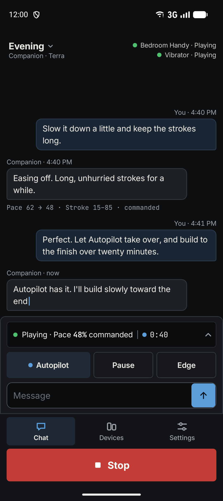

#  MagicHandy Mobile

Chat with an AI companion that can set the pace of your connected intimate devices, or take over with manual controls. **For adults 18 and older.**

**[Download MagicHandy for Android 12 or later](https://github.com/MagicHandy/MagicHandy-Mobile/releases/latest)**

Under **Assets**, tap the file ending in `.apk` and open it. If Android asks, allow installation from the browser or file manager you used. On first launch, confirm your age and try Stop with nothing connected. You can choose a model and add a device during setup or return to either later.

If you used **MagicHandy Test**, the public app installs alongside it. Open **MagicHandy** to sign in and add your devices again. Each app keeps its own chats and settings.

| Chat | Live controls |
|:---:|:---:|
|  |  |

## Using MagicHandy

- **Chat** with the built-in companion or create your own. Turn motion off for conversation only, or let replies adjust motion within the limits you set.
- **Live** lets you set the maximum speed and stroke range, pause, or hold at the edge. **Autopilot** can handle pace changes and check in with you.
- **Stop** sends a stop request to every device in the session. Use the red bar above the keyboard, the notification while connected, or the Stop tile in Quick Settings. The receipt shows which devices confirmed Stop.

## What connects

| Device | Connection |
|---|---|
| The Handy | Bluetooth, Handy Cloud or [Intiface Central](https://intiface.com/central/) |
| Other supported strokers and vibrators | Intiface Central |
| DG-LAB Coyote 3.0 | Bluetooth |
| Autoblow Ultra and VacuGlide | Autoblow Cloud |

**VacuGlide can keep running if the connection drops. Switch it off at the device if that happens.** Intiface answers Stop on behalf of the device, so MagicHandy marks the physical stop as unconfirmed. Keep the device's off switch within reach.

For AI, sign in with ChatGPT, enter an OpenRouter key, or connect to Ollama, llama.cpp or another OpenAI-compatible server on your local network. You can also use manual controls without connecting a model.

## Privacy and updates

Chat history, optional companion memory and settings are stored on your phone and excluded from Android backups. Device keys and sign-in tokens are encrypted using Android Keystore. You can delete chats and memory in App settings.

Your chosen model provider or local server receives the conversation it needs to reply. Handy Cloud and Autoblow Cloud carry commands for devices connected through those services. MagicHandy requires no separate account and collects no analytics.

Check for updates in **App settings**. [Release history](https://github.com/MagicHandy/MagicHandy-Mobile/releases) · [Desktop app](https://github.com/MagicHandy/MagicHandy) · [Developer guide](docs/README.md) · [GPL-3.0-only license](LICENSE) · [Font licenses](third_party/fonts) · [Voice licenses](third_party/voice)
