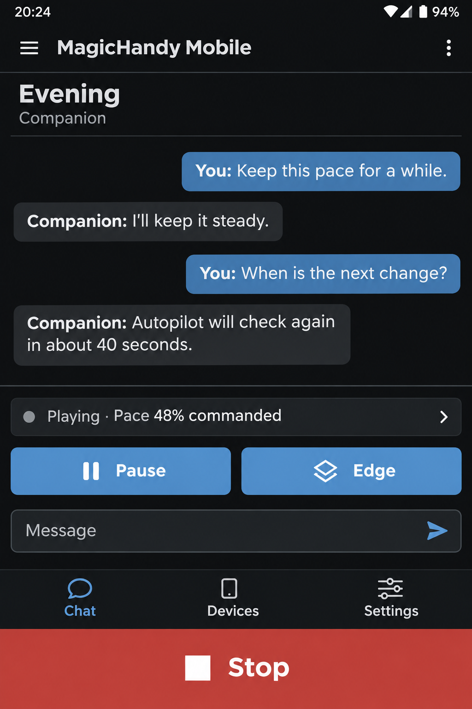
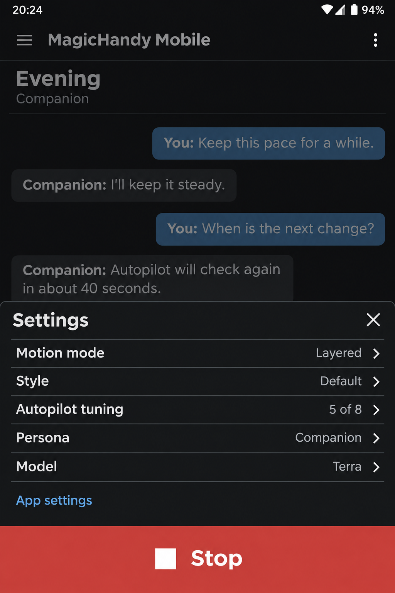
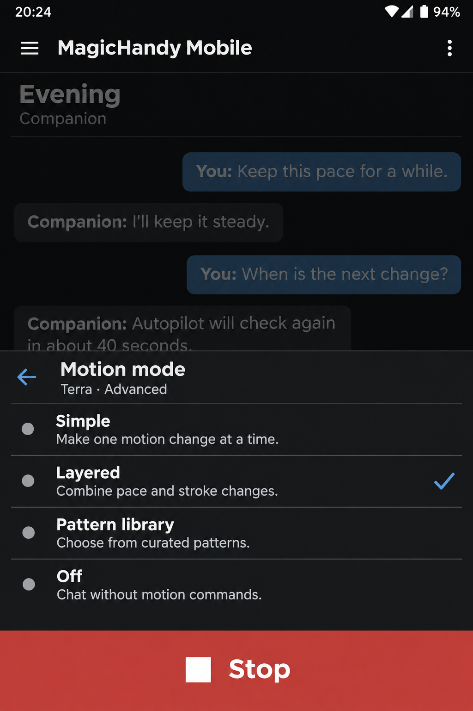

# MagicHandy Mobile · Android design review

18 November 2026 · v1 design recommendation

**Use Graphite Deck for Chat, with one change to its hierarchy.** Give the last row of the app to Stop. Put Chat, Devices and Settings immediately above it. Tap the playing strip to change what is happening now. Tap Settings to change how future replies and plans work. Someone who wants to slow a run should never have to decide which motion mode they are using.

| [Chat](images/01-chat.png) | [Settings](images/02-settings-menu.png) | [Motion mode](images/03-motion-mode-menu.png) |
| --- | --- | --- |
|  |  |  |

## What the current canvas gets right and where it breaks

The sketches are 390 × 844 HTML compositions. Sizes below refer to their CSS pixels. The design targets for Compose use dp for controls and sp for text. This is a review of the supplied files. Physical reach, TalkBack order and large-text reflow still need testing on Android. The overview, architecture and system design also disagree on Stop placement and the colours of device states. The owner’s November 18 rules govern this recommendation. [Overview](../canvas/Main.dc.html) · [Architecture](../../android-architecture-plan.md) · [System design](../../docs/mobile-system-design.md)

| Direction and screens | Keep | Change |
| --- | --- | --- |
| **Graphite Touch** · [GT-Chat.dc.html](../canvas/GT-Chat.dc.html) · [GT-Live.dc.html](../canvas/GT-Live.dc.html) | The chat receipt ties a message to a pace change. Live groups per-device commands and explains their meaning. The explicit “Edge · gentle hold” is worth keeping. | Chat repeats Layered in the upper playing card and a 36 px chip near the composer. Live is a top-of-screen reach. Move the receipt into the conversation after validation, put its commanded value beside the number, and use a single lower strip to open Live. Move the eight narrow timing buttons and check-in interval to Settings. |
| **Graphite Deck** · [GD-Chat.dc.html](../canvas/GD-Chat.dc.html) · [GD-Live.dc.html](../canvas/GD-Live.dc.html) | Best one-handed foundation. Pace, Pause and Edge are near the composer, and the Live speed stepper gives the thumb a clear target. | The strip presents “48%”, a meter, “15–85” and “0:40” without telling a sighted reader which quantity is a limit or a command. Green dots beside device names omit the visible state word. Four chips, the composer, Stop and tabs consume the reading area. Keep one labelled readout, remove Layered, and let Live own the detail. Chat puts tabs below Stop while Live puts Stop last. Use the same footer in both. |
| **Lowlight** · [LL-Chat.dc.html](../canvas/LL-Chat.dc.html) · [LL-Live.dc.html](../canvas/LL-Live.dc.html) | True black and warm text are a useful OLED option. The large pace number works well across a room. Live distinguishes an asked value from the effective value. | On Chat, the eye goes to 48 before the conversation. The small warm labels and sparse dividers make the control groups harder to find in daylight. Borrow large numerals for Live, keep the full “Pace commanded” label beside them, and use the same hit areas and selection outlines in both palettes. Move Layered and timing out of the reading area. |
| **Instrument** · [IN-Chat.dc.html](../canvas/IN-Chat.dc.html) · [IN-Live.dc.html](../canvas/IN-Live.dc.html) | The 72 px Stop key and separate low/high stroke values are easy to locate. Showing requested pace beside the command could explain a limit in one glance. | “SRC”, “VIB”, LEDs, and “AUTO STOP” take decoding under pressure. Top tabs are a long reach. A thumb hides the value on the vertical faders, and the two stroke handles can be confused. Spell out the source and action. Give each bound an accessible name, a value and +/- steps. Keep that precision in Live. |
| **Native** · [NV-Chat.dc.html](../canvas/NV-Chat.dc.html) · [NV-Live.dc.html](../canvas/NV-Live.dc.html) | Familiar Android navigation and sheet handles need little explanation. The actual Chat sketch already has a full-width 64 px Stop button, despite the overview’s floating-action description. | An 80 px navigation bar below Stop lifts it in Chat. The 32 px mode and action chips are small. Live puts “Pause” in the Autopilot group and gives no equally clear Pause-motion or Edge action. Separate the two meanings, anchor Stop, and reserve the app accent and safety colours when applying Material theming. |

### The ten flow screens

| Screen | Where a person could get stuck | Design change |
| --- | --- | --- |
| [F-Devices.dc.html](../canvas/F-Devices.dc.html) | A lost Coyote remains under “In playback” even as the notice says the run continues without it. Green Playing and red Connection lost spend both reserved action colours on status. | Group by actual participation. Put Coyote under “Outside this run” with “● Connection lost” and **Reconnect**. Once connected, show “● Connected · Outside this run”. Rejoining requires a new run. Keep “Continuing without Coyote” only for the opt-in continue policy. Default failure handling stops all owners. |
| [F-AddHandy.dc.html](../canvas/F-AddHandy.dc.html) | Two results called The Handy offer identical Connect buttons. Signal strength can change while the user reaches for one. The Intiface warning is valuable but easy to lose once connected. | Keep scan results in stable order while touching or reading them. Give each a distinguishing identifier when available and invite a local nickname. Show “Verifying…” until profile checks finish, then “● Connected · Idle”. Keep the Intiface Stop-delivery caveat on that connection’s detail page. |
| [F-VacuGlide.dc.html](../canvas/F-VacuGlide.dc.html) | “Stop when this phone goes offline” reads like a guarantee. This cloud device can keep its last speed. A green Test motor is correctly marked as a start action but sits close to the footer. | Say “Send Stop on connection loss”. On uncertainty show “● Stop unconfirmed · Switch off at the device.” Resend Stop when the link returns. Keep the foreground-service prerequisite, physical fallback and optional check-in visible before a motor test. Show its one-minute response window. The 15-minute interval shown is an example, with the default still open. |
| [F-Models.dc.html](../canvas/F-Models.dc.html) | Roles, repair switches, keys, hostnames and capability badges all compete with selecting a model. A ready provider uses green. | Put the active role, human-readable model and capability in the picker. Put sign-in, keys, repair and alternate-server retry in provider management. Keep “● Ready”, “● Not reachable” and “Not encrypted” in plain text where relevant. Show which provider receives messages, persona and memories before changing it. |
| [F-AddServer.dc.html](../canvas/F-AddServer.dc.html) | “Interm.” and “Adv. fast” make a contract choice sound like a speed setting. A successful test gets a green box, and four side-by-side choices leave little room to translate. | Use a vertical capability picker with the four full names. Keep LAN discovery user-initiated, the explicit address and the “Not encrypted” label for permitted local HTTP. Show “● Ready · Replied in 1.9 s” neutrally. If unreachable on cellular, offer one step, “Join the server’s Wi-Fi”. |
| [F-Onboarding.dc.html](../canvas/F-Onboarding.dc.html) | The adults-only acknowledgement competes with three permission requests. “Stop from the lock screen” reads as unconditional if the person later denies notification access. | Keep the adult acknowledgement. Demonstrate Stop with no connected device. Request Nearby devices at Bluetooth setup. Explain notifications beside the system prompt and keep a visible recovery action when access is denied. Treat battery settings as a separate choice. |
| [F-Keyboard.dc.html](../canvas/F-Keyboard.dc.html) | The dedicated footer becomes a 76 × 48 px button beside Message. It changes side, size and relationship to Send just when the transcript is moving. | Hide navigation while typing and shrink the transcript first. Keep the same full-width 60 dp Stop row below the composer, immediately above the docked keyboard. Keep Send inside the composer. A keyboard inset changes the physical height of the app window, which matters for the placement test below. |
| [F-ConnectionLost.dc.html](../canvas/F-ConnectionLost.dc.html) | “Every device stopped” can precede transport acknowledgements. “Autopilot paused” sounds temporary after a Stop. Reconnect, Devices and Send again compete for the next tap. | For confirmed outcomes, say “● Stopped · Handy disconnected” and offer **Reconnect**. For an uncertain owner, lead with “● Stop unconfirmed · Check Handy locally”. Show “Autopilot off” after Stop. Keep the interrupted reply in the transcript and make any resend deliberate. |
| [F-Restored.dc.html](../canvas/F-Restored.dc.html) | The screen attributes the exit to memory pressure and claims the Handy paused. A surviving journal establishes interruption and the last command. It cannot establish the kill reason or physical outcome. | Lead with the device that may still run. Send recovery Stop to saved cloud devices on cold start. Show per-device reply or uncertainty and timestamp, such as “● Unconfirmed · Switch off VacuGlide at the device”. Identify expected buffer expiry separately. Restore chat context with motion and Autopilot off. |
| [F-System.dc.html](../canvas/F-System.dc.html) | Stop, Pause, Edge and Open carry similar weight in the notification. “Pace 48%” lacks its qualifier. A system tile can look like a playback toggle. | Notification and lock screen expose direct Stop. The tile has one action, **Stop motion**, in every state. Use “● Playing · Pace 48% commanded” in the private expanded view, and a discreet public status with Stop. Provide an **Open limits** shortcut in the expanded view. Report denied notification access in-app. |

## Interaction specification

**Stop belongs to the app frame.** Draw one full-width 60 dp red row, white square and “Stop”, immediately above the bottom system inset. Place the navigation, composer, every sheet and every scrim above it. Tabs can disappear on subpages without shifting Stop. Keep the row enabled during setup, sign-in preparation, a stalled model request and a failed settings save. Its no-device result is “No connected device to stop.” The app controls its own windows. Android owns permission dialogs, external sign-in, the keyboard, notification layouts and tile styling.

**Keyboard acceptance criterion.** On every app route with the same window insets, the footer bounds must match. With a docked keyboard, its bottom edge follows the bottom of the visible app, directly above the keys. A fixed physical screen coordinate under a system keyboard cannot also be a visible app button. Validate this interpretation of “same place” on a phone with typing, landscape and split screen before signing off this rule. Check that the bar takes one tap even with a sheet open or the keyboard focused.

**Stop feedback has two moments.** An immediate haptic acknowledges the press. The action goes directly to the shared emergency Stop path, fences late commands, cancels the chat turn and Autopilot, and stops every device owner. Then report the transport results. Show “● Stopping” while results are pending. Aggregate as confirmed, pending, unconfirmed or no device, with the uncertain device named first. Acknowledge an Intiface reply as a bridge acknowledgement when end-device delivery is unknown. Announce the outcome assertively to TalkBack. Pause holds a run for deliberate Resume. Edge requests a gentle hold within the limits. “Pause Autopilot” suspends planning and must say what the current segment is doing.

**Colour and access.** Use a neutral dot plus a visible word for all states, including Connected, Playing, Held and Lost. A checkmark and spoken “selected” identify the current choice. Graphite uses #5B9DD9 for interactive emphasis, #287D42 for explicit motion starts such as Resume, and #C43C36 only for Stop. Neutral text and icons carry warnings. Aim for at least 4.5:1 for normal text and 3:1 for large text and meaningful control boundaries. Give ordinary controls at least 48 × 48 dp targets. At 200% font size, stack secondary values under labels and allow the content above Stop to scroll. Announce a completed reply or changed state once. Suppress meter animation with reduced motion and avoid speaking every streamed token or pace tick.

### Main surfaces, compact menu and deeper settings

| Surface | What the user can do there |
| --- | --- |
| **Chat** | Switch sessions from the session title, read streaming replies and compose a message. A reachable one-line “● Playing · Pace 48% commanded ›” opens Live. Keep Pause and Edge within thumb reach during a run. Give a validated command a short transcript receipt. At large font sizes allow the strip to wrap. Use a textual Autopilot state in Live and a concise update in Chat when control changes hands. |
| **Live** | See the source, each participating device’s commanded output, top speed and stroke limits. Apply limits immediately to every source. Keep Pause, explicit Resume, Edge and Autopilot start/pause/end here. Show the estimated next check and a link to run history. A limit adjustment, view change or settings selection never starts a run. |
| **Devices** | Connect, name and inspect Handy over Bluetooth, Cloud or Intiface, including several Handys. Show Intiface vibrators, Coyote 3.0, Autoblow Ultra and VacuGlide with their own transport, status, limits and Stop outcome. Keep VacuGlide safeguards and Coyote’s explicit device selection in setup and device detail. Use one engine for all participants. |
| **Settings menu** | Edit the active session in five rows. The current value sits at the right at normal type sizes. **App settings** below the rows opens durable preferences. |
| **App settings** | Manage model connections and their capability, role defaults, permissions, device-failure policy, palette including OLED, language, haptics, memory/history preferences, persona import and redacted diagnostics export. Link to the same device detail or provider editor used elsewhere. |

**Entry and navigation.** The labelled sliders button **Settings** is the third item in the bottom row alongside Chat and Devices. It opens a sheet in place and preserves the session, draft and scroll position. In Live, a labelled Settings action opens the same sheet with the same session context. Use one in-window sheet host above Stop. The background becomes inert, and both sheet content and Stop remain in the accessible focus order. Back returns from Motion mode to Settings, then closes Settings and restores focus to its opener. A visible Close button and Android Back duplicate swipe-to-dismiss. A taller font or a short landscape window expands the sheet to the available height and scrolls its rows.

| Row, in order | Example value | What opens |
| --- | --- | --- |
| **Motion mode** | Layered | A single-choice list for the active chat model. Display the model and its capability above the options. |
| **Style** | Default | A short list of response styles with a one-line example for each supported style. This proposal treats Style as the way replies are written. The palette belongs in App settings and the limits belong in Live. |
| **Autopilot tuning** | 5 of 8 | Change frequency with labelled steps, check-in frequency and session buildup. Describe check-ins as chat messages in v1. Changing timing affects future planning. Starting Autopilot is an explicit action in Live. |
| **Persona** | Companion | Pick a built-in or previously imported persona. Explain when the choice takes effect on the next reply. Link to import in App settings. |
| **Model** | Terra | Choose a saved chat connection. Show provider, capability and destination. Also show the Autopilot assignment, usually “Same as chat”, with a separate picker if overridden. “Manage connections” opens the full Models screen. |

### Motion mode and capability

| Menu label | One-line description shown in the picker |
| --- | --- |
| **Simple** | Make one motion change at a time. |
| **Layered** | Combine pace and stroke changes. |
| **Pattern library** | Choose from curated patterns. |
| **Off** | Chat without motion commands. |

Simple is the user-facing name for Creative v2. Map an existing Creative v2 selection to Simple. Pattern library selects from the curated set shipped with the app. Keep editing and importing patterns out of this picker. A connection’s capability is configured once in Models and determines which contracts the mobile port can use. Users select motion mode manually. “Advanced (no reasoning)” describes request configuration and should never appear as “Adv. fast”.

**Proposed availability for design review.** The architecture specifies four levels and tuned contracts, but gives no authoritative cell-by-cell mode matrix. The table below is a conservative prototype assumption. In production each enabled cell must come from the validated contract map for that connection and role, using the port’s request and response fixtures. Preserve any additional supported combinations found there. A provider name or a successful connection test alone establishes no motion capability.

| Connection capability | Simple | Layered | Pattern library | Off |
| --- | --- | --- | --- | --- |
| Simple | Available | Unavailable | Unavailable | Available |
| Intermediate | Available | Unavailable pending contract verification | Unavailable pending contract verification | Available |
| Advanced (no reasoning) | Available | Available | Available | Available |
| Advanced | Available | Available | Available | Available |

Show all four rows in a stable order, check the active one, and expose unavailable rows with a readable reason such as “Layered is unavailable for this connection”. A tap on an available mode saves the choice and returns to Settings with the new value. Commit against the current connection and settings revision. A change while a reply is streaming must fence its old motion output. Display a failed save with one **Try again** action and keep the last committed checkmark.

If switching models would invalidate a mode, show the new model and the available choices before committing the switch. Preselect Off as the safe suggestion and let the user choose. Back preserves the previous model and mode together. Keep chat and Autopilot role capability checks independent. Selecting **Off** disables new motion commands from chat. If independent Autopilot is active, explicitly say “Chat motion off · Autopilot active” with its state dot in Live. Stop remains the immediate way to end every source. Selecting a mode, connecting or reconnecting sends no motion command.

## Ten mobile enhancements

Effort is relative to the planned native core. **S** uses existing state and UI components. **M** adds a view or coordinates several states. **L** crosses device, service or operating-system boundaries.

| Idea | What it does and why it helps | Rule or trade-off | Effort |
| --- | --- | --- | --- |
| **1. Run history** | From Live, read the last few meaningful changes. Each entry names the actor, request, applied limit and command when available. In the concept, Autopilot requests 56%, the cap yields 50%, then the user asks for 48%. This answers “Who changed it?” without rereading chat. | Record accepted changes, separate the estimated next check, label commands, and keep raw device samples and private chat out of the log. | M |
| **2. Per-device Stop receipt** | After one Stop press, show a compact summary above the footer. Expand “One device unconfirmed” to see its name, transport and last reply. The person can tell which device needs local attention. | Haptics confirm the press only. Keep the uncertain result visible and give one action, “Check the device locally”. Stop remains tappable. | M |
| **3. One-handed limit steps** | Give top speed, low stroke and high stroke separate minus/plus buttons alongside the slider. A person holding a phone with one hand can make a precise adjustment without covering either thumb handle. | Expose each bound and value to TalkBack, enforce low ≤ high and apply the same limits to chat and Autopilot. An edit while idle leaves output idle. | S |
| **4. Named run roster** | Put a local nickname and transport on each row. Group two similar Handys by participation. Keep the selected scan result stable and preserve the label when a device drops. | Show actual membership, including “Connected · Outside this run”. Reconnecting never rejoins a run, and matching command values promise no physical synchronisation. | M |
| **5. Interrupt-aware planner strip** | When Wi-Fi disappears, replace the countdown with “● Planning held”. On Bluetooth, say whether the current planned segment is still playing. On Handy Cloud, show the lost stream. This tells the user what still needs attention. | Resume planning only for a surviving eligible run. Stop, process death and a retired device connection require deliberate restart. A cloud reconnect can trigger a recovery Stop. | M |
| **6. Private lock-screen controls** | Show a neutral app status and Stop on the public notification, with named devices, commanded pace and estimated next check in the private expanded view. The user can act without exposing the transcript. | Wire Stop directly to the service. If notifications are denied, show “Lock-screen Stop unavailable” and **Open notification settings**. Android chooses the system action styling. | M |
| **7. No-device Stop rehearsal** | During adult onboarding, invite the user to press the real footer while no devices are connected. Return the normal haptic and “No connected device to stop.” Let them locate the Quick Settings tile. | The rehearsal sends no start command. Keep the same footer during connection setup and after onboarding. | S |
| **8. Readable live updates** | Coalesce streaming text into complete utterances for TalkBack. Speak state transitions, allow a user-requested reading of current commanded values, and preserve reading position when a new message arrives. | Stop outcomes interrupt politely queued speech. No flashing caret or animated meter in reduced-motion mode. | M |
| **9. Recovery card after interruption** | On relaunch show the journal time, devices, last commanded values and current recovery results. Put the uncertain owner first, with one specific next step. This avoids reconstructing events from a chat transcript. | Send the saved-cloud-device recovery Stop first. State uncertainty plainly, especially for VacuGlide. Reconnect restores a link only. | M |
| **10. Optional hands-busy Stop** | In the foreground, let the user enable and rehearse the documented volume-down hold. It helps when the screen is hard to see. Keep the tile and lock-screen action as the outside-app paths. | A shortcut can conflict with normal volume use or accessibility services. Make it opt-in, local to the foreground and Stop-only. Its haptic has the same meaning as a footer press. | M |

## Two additional visual directions

| Direction | Canvas / surface | Text / secondary | Interactive accent | Start / Stop | Type and shapes |
| --- | --- | --- | --- | --- | --- |
| **Night Folio** | #19171D / #26222A | #F1E8DC / #BEB1AE | Lavender #BCA8F5 | #287D42 / #C43C36 with white labels | Spectral for title and Companion prose, Source Sans 3 for controls and numbers. Unboxed paragraphs, hanging timestamps, ruled sections and a square-ended footer. |
| **Indigo Index** | #121623 / #1D2435 | #EDF0F7 / #AAB3C7 | Pale apricot #FFC68F | #287D42 / #C43C36 with white labels | Atkinson Hyperlegible Next with tabular numerals where available. Broad rectangular rows, short section tabs and aligned value columns. |

**Night Folio** gives long conversations the rhythm of a printed dialogue. Names and times stay in the margin while each message gets a readable line length. A short lavender rule identifies the user’s paragraph, and an explicit speaker label survives monochrome viewing. The small sans-serif control deck remains visually distinct from the prose. Let timestamps stack above messages at large font sizes so the margin never squeezes the writing. [Playing chat concept](images/05-direction-a.png)

**Indigo Index** makes the device list read like a directory. The user first sees who is in the run, then reads each connection’s name, transport and state along the row. It accommodates two Handys with identical commands but different network paths. At large type, stack the columns within each row and retain the section heading and status word. Apricot picks out actions, and the solid Stop footer keeps its familiar location. [Device roster concept](images/06-direction-b-or-idea.png)

## Concept images and generation record

All six are separate portrait PNGs generated with the built-in image tool. The first three form one interaction sequence. The pixels illustrate hierarchy and wording. Use the written 60 dp footer, 48 dp minimum row targets and exact palette tokens in Compose. The renderer gives the later explorations slightly different footer heights, adds upper menu icons on some screens and gives the Index roster weak selected-tab emphasis. Use the labelled bottom entry, a clear navigation selection indicator and the shared footer component in the app.

| Image | What it shows | Exact prompt record |
| --- | --- | --- |
| [01-chat.png](images/01-chat.png) | Graphite Chat during playback, with the one-line commanded pace and the Settings entry. | [Prompt 1](#prompt-1) |
| [02-settings-menu.png](images/02-settings-menu.png) | Compact Settings above the same chat, with five session rows. | [Prompt 2](#prompt-2) |
| [03-motion-mode-menu.png](images/03-motion-mode-menu.png) | Motion mode for an Advanced connection, with Layered selected. | [Prompt 3](#prompt-3) |
| [04-idea.png](images/04-idea.png) | Run history, including the request that hit a speed limit. | [Prompt 4](#prompt-4) |
| [05-direction-a.png](images/05-direction-a.png) | Night Folio, the editorial chat direction. | [Prompt 5](#prompt-5) |
| [06-direction-b-or-idea.png](images/06-direction-b-or-idea.png) | Indigo Index, showing two Handys in a run and one connected vibrator outside it. | [Prompt 6](#prompt-6) |

The blocks reproduce the exact text sent. For images 2 and 3 the final edit used image 1 as its visual reference. Image 6 used its initial generated roster as the reference for a navigation correction. The blocks are collapsed in renderers that support disclosure controls.

### Prompt 1

<details>
<summary>01-chat.png · generation</summary>

```text
Create one 1024×1536 portrait PNG, a crisp, flat Android app screenshot for MagicHandy Mobile. UI fills the canvas edge to edge. Only the digital interface: no phone frame, physical devices, people, bodies, photos, suggestive imagery, watermarks or poster captions. Use readable naturally sized type, generous touch targets, precise alignment. Every state has a small neutral dot AND its state word. No green anywhere in this screen. Red appears ONLY in the permanent Stop button. End with the exact same uninterrupted opaque red #C43C36 rectangle spanning the entire bottom edge from x=0 to x=1024, 144 pixels tall, square corners, centered white square icon and white bold label “Stop”. Nothing below it. No glow, gradients or shadows.

Graphite Deck: near-black #0E0F11 background, #16181B panels, #E9E7E2 text, #5B9DD9 steel azure as the sole interactive accent. Inter typography, tabular numbers, flat controls, 4dp corners and thin neutral dividers.

Chat while playing. At top a small Android status bar, session title “Evening” and subtitle “Companion”. Create a quiet conversation with legible speaker labels: You: “Keep this pace for a while.” Companion: “I’ll keep it steady.” You: “When is the next change?” Companion: “Autopilot will check again in about 40 seconds.” Lower thumb deck in this order: one single-line strip “● Playing · Pace 48% commanded” with right chevron for Live, two buttons “Pause” and “Edge”, a “Message” composer with send arrow, a small bottom navigation row “Chat”, “Devices”, “Settings” with a clear sliders icon beside Settings, then the Stop footer. No motion-mode name, mode chip or tuning controls on Chat.
```

</details>

### Prompt 2

<details>
<summary>02-settings-menu.png · initial generation and final edit</summary>

**Initial generation**

```text
Create one 1024×1536 portrait PNG, a crisp, flat Android app screenshot for MagicHandy Mobile. UI fills the canvas edge to edge. Only the digital interface: no phone frame, physical devices, people, bodies, photos, suggestive imagery, watermarks or poster captions. Use readable naturally sized type, generous touch targets, precise alignment. Every state has a small neutral dot AND its state word. No green anywhere in this screen. Red appears ONLY in the permanent Stop button. End with the exact same uninterrupted opaque red #C43C36 rectangle spanning the entire bottom edge from x=0 to x=1024, 144 pixels tall, square corners, centered white square icon and white bold label “Stop”. Nothing below it. No glow, gradients or shadows.

Graphite Deck: near-black #0E0F11 background, #16181B panels, #E9E7E2 text, #5B9DD9 steel azure as the sole interactive accent. Inter typography, tabular numbers, flat controls, 4dp corners and thin neutral dividers.

Show the compact Settings bottom sheet open over the dimmed Evening chat. Leave some chat visible at top (“Evening”, “Keep this pace for a while.”). An opaque sheet in the lower half ends flush against the vivid unobscured Stop footer. Heading “Settings”, small close X, exactly five compact full-width rows. Left aligned label then a quieter right value and chevron: “Motion mode” / “Layered”; “Style” / “Default”; “Autopilot tuning” / “5 of 8”; “Persona” / “Companion”; “Model” / “Terra”. A small separate footer link “App settings”. Balanced row heights, a single clear hierarchy. No toggle, extra tabs or other buttons.
```

**Final edit**

```text
Edit the attached Graphite chat screenshot. Keep its exact header, session name, subtitle and visible conversation pixels at their existing locations and merely dim them under a translucent scrim. Do not redraw chat behind the sheet. Preserve the red Stop footer from the input pixel for pixel at the identical location, brightness and height. Overlay one compact, opaque settings sheet immediately above Stop, covering the navigation, composer and the lower portion of chat. The title, rows and descriptions follow below.

Create one 1024×1536 portrait PNG, a crisp, flat Android app screenshot for MagicHandy Mobile. UI fills the canvas edge to edge. Only the digital interface: no phone frame, physical devices, people, bodies, photos, suggestive imagery, watermarks or poster captions. Use readable naturally sized type, generous touch targets, precise alignment. Every state has a small neutral dot AND its state word. No green anywhere in this screen. Red appears ONLY in the permanent Stop button. End with the exact same uninterrupted opaque red #C43C36 rectangle spanning the entire bottom edge from x=0 to x=1024, 144 pixels tall, square corners, centered white square icon and white bold label “Stop”. Nothing below it. No glow, gradients or shadows.

Graphite Deck: near-black #0E0F11 background, #16181B panels, #E9E7E2 text, #5B9DD9 steel azure as the sole interactive accent. Inter typography, tabular numbers, flat controls, 4dp corners and thin neutral dividers.

Show the compact Settings bottom sheet open over the dimmed Evening chat. Leave some chat visible at top (“Evening”, “Keep this pace for a while.”). An opaque sheet in the lower half ends flush against the vivid unobscured Stop footer. Heading “Settings”, small close X, exactly five compact full-width rows. Left aligned label then a quieter right value and chevron: “Motion mode” / “Layered”; “Style” / “Default”; “Autopilot tuning” / “5 of 8”; “Persona” / “Companion”; “Model” / “Terra”. A small separate footer link “App settings”. Balanced row heights, a single clear hierarchy. No toggle, extra tabs or other buttons.
```

</details>

### Prompt 3

<details>
<summary>03-motion-mode-menu.png · initial generation and final edit</summary>

**Initial generation**

```text
Create one 1024×1536 portrait PNG, a crisp, flat Android app screenshot for MagicHandy Mobile. UI fills the canvas edge to edge. Only the digital interface: no phone frame, physical devices, people, bodies, photos, suggestive imagery, watermarks or poster captions. Use readable naturally sized type, generous touch targets, precise alignment. Every state has a small neutral dot AND its state word. No green anywhere in this screen. Red appears ONLY in the permanent Stop button. End with the exact same uninterrupted opaque red #C43C36 rectangle spanning the entire bottom edge from x=0 to x=1024, 144 pixels tall, square corners, centered white square icon and white bold label “Stop”. Nothing below it. No glow, gradients or shadows.

Graphite Deck: near-black #0E0F11 background, #16181B panels, #E9E7E2 text, #5B9DD9 steel azure as the sole interactive accent. Inter typography, tabular numbers, flat controls, 4dp corners and thin neutral dividers.

Show the second level of the same compact sheet open over dim Evening chat. Sheet title “Motion mode” with back arrow, subtitle “Terra · Advanced”. Four large single-select rows with title and one line of secondary text apiece, verbatim: “Simple” / “Make one motion change at a time.”; “Layered” / “Combine pace and stroke changes.”; “Pattern library” / “Choose from curated patterns.”; “Off” / “Chat without motion commands.” Put one azure checkmark at the trailing edge of Layered only. No word Selected needed and no extra values. End sheet just above the same unobscured Stop footer.
```

**Final edit**

```text
Edit the attached Graphite chat screenshot. Dim the existing chat under a scrim, preserving its existing header, conversation and layout. Only a portion of the original chat should show at top. Do not invent titles or tabs. Preserve the red Stop footer from the input pixel for pixel at the identical location, brightness and height. Overlay a compact, opaque sheet above Stop, covering the navigation, composer and lower chat. The sheet title and rows follow below.

Create one 1024×1536 portrait PNG, a crisp, flat Android app screenshot for MagicHandy Mobile. UI fills the canvas edge to edge. Only the digital interface: no phone frame, physical devices, people, bodies, photos, suggestive imagery, watermarks or poster captions. Use readable naturally sized type, generous touch targets, precise alignment. Every state has a small neutral dot AND its state word. No green anywhere in this screen. Red appears ONLY in the permanent Stop button. End with the exact same uninterrupted opaque red #C43C36 rectangle spanning the entire bottom edge from x=0 to x=1024, 144 pixels tall, square corners, centered white square icon and white bold label “Stop”. Nothing below it. No glow, gradients or shadows.

Graphite Deck: near-black #0E0F11 background, #16181B panels, #E9E7E2 text, #5B9DD9 steel azure as the sole interactive accent. Inter typography, tabular numbers, flat controls, 4dp corners and thin neutral dividers.

Show the second level of the same compact sheet open over dim Evening chat. Sheet title “Motion mode” with back arrow, subtitle “Terra · Advanced”. Four large single-select rows with title and one line of secondary text apiece, verbatim: “Simple” / “Make one motion change at a time.”; “Layered” / “Combine pace and stroke changes.”; “Pattern library” / “Choose from curated patterns.”; “Off” / “Chat without motion commands.” Put one azure checkmark at the trailing edge of Layered only. No word Selected needed and no extra values. End sheet just above the same unobscured Stop footer.
```

</details>

### Prompt 4

<details>
<summary>04-idea.png · generation</summary>

```text
Create one 1024×1536 portrait PNG, a crisp, flat Android app screenshot for MagicHandy Mobile. UI fills the canvas edge to edge. Only the digital interface: no phone frame, physical devices, people, bodies, photos, suggestive imagery, watermarks or poster captions. Use readable naturally sized type, generous touch targets, precise alignment. Every state has a small neutral dot AND its state word. No green anywhere in this screen. Red appears ONLY in the permanent Stop button. End with the exact same uninterrupted opaque red #C43C36 rectangle spanning the entire bottom edge from x=0 to x=1024, 144 pixels tall, square corners, centered white square icon and white bold label “Stop”. Nothing below it. No glow, gradients or shadows.

Graphite Deck: near-black #0E0F11 background, #16181B panels, #E9E7E2 text, #5B9DD9 steel azure as the sole interactive accent. Inter typography, tabular numbers, flat controls, 4dp corners and thin neutral dividers.

Show a live Autopilot run in the proposed “Run history” screen. Build a readable chronological log rather than a dashboard. Header “Run history”, subtitle “Evening · Autopilot”. Dominant status strip “● Playing · Pace 48% commanded”. Under “Recent changes” show two timestamped ledger entries with hairline separators: “21:40   You lowered top speed” with detail “Limit set to 50%”; “21:41   Autopilot changed pace” with detail “Requested 56% · Commanded 50%”. Below, “21:42   You changed pace” and “Commanded 48%”. Separate future from history in one flat lower card “Next planner check” / “In about 40 s”. Two reachable secondary buttons “Live controls” and “Pause Autopilot”. Finish with permanent Stop.
```

</details>

### Prompt 5

<details>
<summary>05-direction-a.png · generation</summary>

```text
Create one 1024×1536 portrait PNG, a crisp, flat Android app screenshot for MagicHandy Mobile. UI fills the canvas edge to edge. Only the digital interface: no phone frame, physical devices, people, bodies, photos, suggestive imagery, watermarks or poster captions. Use readable naturally sized type, generous touch targets, precise alignment. Every state has a small neutral dot AND its state word. No green anywhere in this screen. Red appears ONLY in the permanent Stop button. End with the exact same uninterrupted opaque red #C43C36 rectangle spanning the entire bottom edge from x=0 to x=1024, 144 pixels tall, square corners, centered white square icon and white bold label “Stop”. Nothing below it. No glow, gradients or shadows.

New design direction, Night Folio: a warm editorial chat transcript, dark plum-black paper #19171D, raised surface #26222A, parchment #F1E8DC, muted text #BEB1AE, lavender #BCA8F5 as the single interactive accent. Spectral serif for the session title and Companion reply, Source Sans 3 for labels, actions and numbers. Left-aligned text, hanging time labels, long horizontal hairlines, unboxed messages, narrow lavender left rule on the user's paragraph. No bubbles. Sparse, quiet and highly legible. Session “Evening”, two passages “You” / “Keep it steady.” and “Companion” / “I’ll hold this pace until you ask for a change.” Compact lower deck: “● Playing · Pace 48% commanded” on one line; “Pause” and “Edge”; “Message” composer; “Chat”, “Devices”, “Settings” bottom navigation. No mode chip.
```

</details>

### Prompt 6

<details>
<summary>06-direction-b-or-idea.png · initial generation and final edit</summary>

**Initial generation**

```text
Create one 1024×1536 portrait PNG, a crisp, flat Android app screenshot for MagicHandy Mobile. UI fills the canvas edge to edge. Only the digital interface: no phone frame, physical devices, people, bodies, photos, suggestive imagery, watermarks or poster captions. Use readable naturally sized type, generous touch targets, precise alignment. Every state has a small neutral dot AND its state word. No green anywhere in this screen. Red appears ONLY in the permanent Stop button. End with the exact same uninterrupted opaque red #C43C36 rectangle spanning the entire bottom edge from x=0 to x=1024, 144 pixels tall, square corners, centered white square icon and white bold label “Stop”. Nothing below it. No glow, gradients or shadows.

New direction, Indigo Index: a matte dark indigo #121623 background, #1D2435 surfaces, #EDF0F7 text, #AAB3C7 secondary, pale apricot #FFC68F as sole interactive accent. Use Atkinson Hyperlegible Next, wide readable numbers. A well-spaced device roster like a thumb-indexed directory: broad rectangular rows, a short inset left-edge tab on each section, aligned label/value columns. No gauges, LEDs or simulated machinery. Heading “Devices”, subtitle “Evening”. Section “In this run”: “Handy One” with “● Playing” and “Bluetooth · Pace 48% commanded”; “Handy Two” with “● Playing” and “Cloud · Pace 48% commanded”. Section “Outside this run”: “Vibrator” with “● Connected” and “Intiface · Idle”. Plain one-line note “Connecting never starts motion.” A lower action “Add a device”, then “Chat”, “Devices”, “Settings” navigation. Stop footer as specified.
```

**Final edit**

```text
Edit the attached Indigo Index Devices screen. Fix the oversized column of three navigation rows at the bottom. Replace them with a single horizontal bottom navigation row with THREE EQUAL-WIDTH TABS side by side: Chat on the left, Devices in the center (selected), Settings on the right. Small icon above each label. Keep “Add a device” as a separate button above the row. Remove the top right hamburger. Preserve the readable roster with its status words and commanded labels, and the full width red Stop footer. The design spec follows.

Create one 1024×1536 portrait PNG, a crisp, flat Android app screenshot for MagicHandy Mobile. UI fills the canvas edge to edge. Only the digital interface: no phone frame, physical devices, people, bodies, photos, suggestive imagery, watermarks or poster captions. Use readable naturally sized type, generous touch targets, precise alignment. Every state has a small neutral dot AND its state word. No green anywhere in this screen. Red appears ONLY in the permanent Stop button. End with the exact same uninterrupted opaque red #C43C36 rectangle spanning the entire bottom edge from x=0 to x=1024, 144 pixels tall, square corners, centered white square icon and white bold label “Stop”. Nothing below it. No glow, gradients or shadows.

New direction, Indigo Index: a matte dark indigo #121623 background, #1D2435 surfaces, #EDF0F7 text, #AAB3C7 secondary, pale apricot #FFC68F as sole interactive accent. Use Atkinson Hyperlegible Next, wide readable numbers. A well-spaced device roster like a thumb-indexed directory: broad rectangular rows, a short inset left-edge tab on each section, aligned label/value columns. No gauges, LEDs or simulated machinery. Heading “Devices”, subtitle “Evening”. Section “In this run”: “Handy One” with “● Playing” and “Bluetooth · Pace 48% commanded”; “Handy Two” with “● Playing” and “Cloud · Pace 48% commanded”. Section “Outside this run”: “Vibrator” with “● Connected” and “Intiface · Idle”. Plain one-line note “Connecting never starts motion.” A lower action “Add a device”, then “Chat”, “Devices”, “Settings” navigation. Stop footer as specified.
```

</details>

## Changes to make first

1. **Fix the Stop frame and its outcomes.** Prototype Chat → Settings → Motion mode → keyboard with one persistent footer. Check one-tap access, 200% type, TalkBack and insets. Verify that an unconfirmed transport can never produce “Every device stopped”.
2. **Simplify Chat.** Keep the commanded pace strip, Pause, Edge and composer within reach. Move the manual mode picker and planner tuning into the compact Settings sheet.
3. **Verify the capability table.** Exercise a model change that invalidates Layered, a refused settings save and a streamed reply arriving after a change. Show the committed mode and prevent stale output.
4. **Make loss and recovery readable per device.** Test two Handys, Intiface acknowledgement, VacuGlide offline and Android relaunch. Each uncertain device needs a named outcome and one next step.
5. **Prototype run history on a phone.** Ask someone to explain why a 56% request produced a 50% command, then find Pause Autopilot and Stop by touch. Use the results to settle the Live layout before polishing the optional palettes.
