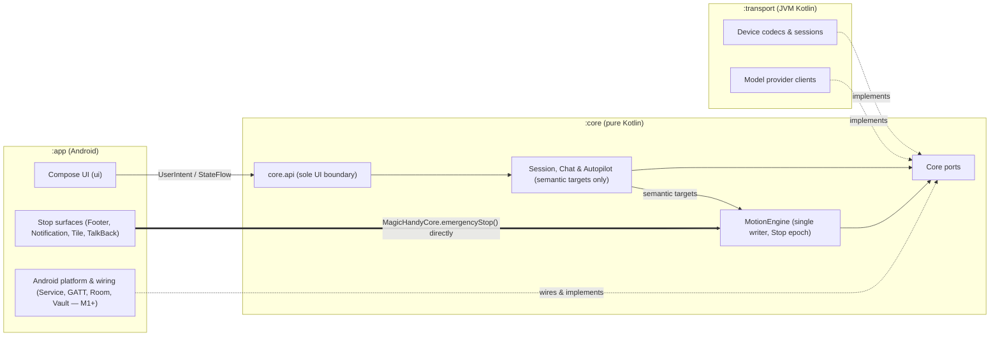

# Developer guide

   

This guide is for people working on MagicHandy Mobile: how it's built, where it stands and how to contribute. The [README](../README.md) describes the app for the people who use it.

## Principles

- **Stop is safety-critical and always reachable.** A full-width Stop bar sits as the last row of every screen (staying directly above the keyboard while you type) alongside a TalkBack action ("Stop all motion") available from any screen. The ongoing notification's action (including on the public lock screen), a Quick Settings tile and the Autoblow device buttons the desktop maps to Emergency Stop do the same. Every Stop surface calls `MagicHandyCore.emergencyStop` directly, never through a queue, storage or UI state. Stop advances the epoch first, stops every device in parallel and reports an honest per-device receipt.
- **One motion engine writes to devices.** A single process-wide engine owns all output. Chat and Autopilot emit semantic targets only, enforced by module boundaries and ArchUnit tests.
- **Remote inference first.** Designed for ChatGPT sign-in, OpenRouter and servers on your local network (Ollama, `llama.cpp` and other OpenAI-compatible servers), with Simple, Intermediate and Advanced capability contracts. On-device inference for Qualcomm and Tensor is planned after v1 in a separate process so a native crash cannot take down motion or Stop.
- **Built for mobile realities.** A versioned run journal is armed durably before the first motion-capable write ("no journal, no start"), so cold starts after process death recover honestly on the Run interrupted screen without restarting motion. Cloud devices that keep running if the host dies (such as VacuGlide) carry dedicated disconnect, check-in and recovery safeguards.

## Architecture

Three Gradle modules separate pure business logic, wire transports and Android platform code. `com.magichandy.mobile.core.api` (`core.api`) is the only boundary between the Compose UI and everything behind it, enforced by `UiBoundaryTest` and `ArchitectureTest`.



The thick arrow is the safety rule: Stop never waits behind UI state, an intent queue, model I/O or storage.

## Current status

As of 2026-11-20, all five milestones (M0–M4) are built, UI included. There's no release yet: the app runs as a debug build, and the release build still needs testing on a phone.

- **Working in debug builds:** the full Compose UI on the real core, with five simulated device families and canned model replies. The simulated Handy runs the real Bluetooth RPC session against an in-memory peer. Debug builds also use the real foreground service and its notification.
- **Built for release, with phone testing still to do:** the foreground service and its notification, Stop from the notification and from a Quick Settings tile, Android Bluetooth (GATT), Room storage, the on-disk run journal, the Keystore vault, ChatGPT sign-in through a Custom Tab, network monitoring and diagnostics. The [phone checklist](backend/device-checklist.md) lists what only a phone can prove.
- **Verified automatically:** `./gradlew check` passes ktfmt formatting, Android Lint (warnings as errors), debug and release builds, a check of the shrunk release APK's contents, and **700 JVM tests** (225 in `:core`, 122 in `:transport` and 353 in `:app`). The app's tests include Robolectric tests that build the release graph, 268 palette contrast checks and screenshots of all 60 previews. The Kotlin motion compiler matches all 135 desktop atlas cases.
- **Left before a release:** phone acceptance on real devices and accounts, then a signed release ([release guide](release.md)). See the [frontend status](frontend/status.md).

<details>
<summary>v1 milestones (M0–M4), planned devices, model providers and out-of-scope features</summary>

### Milestones

v1 ships as a whole once M0–M4 are complete; milestones only order the work ([android-architecture-plan.md](../android-architecture-plan.md) §11).

| Milestone | Scope | Status |
|---|---|---|
| **M0: Fixtures and spike** | Exported desktop verification fixtures, 3-module Gradle setup, 21-case bounded-ramp sampler, Stop and run-journal core, Handy protocol spike, hosted Responses/OAuth spike, debug wiring and Compose UI | Complete; the Pixel measurements are on the phone checklist |
| **M1: Engine, The Handy, hosted chat** | Full motion engine (all 135 atlas cases), Handy Cloud and real Bluetooth GATT, Advanced motion chat with repair and memory, ChatGPT and OpenRouter, Android service, Room, Keystore, notification and Quick Settings tile | Complete; phone testing pending |
| **M2: Autopilot** | Hosted planner with auto timing (ADR 0072), check-ins, optional finish target, background runs and Recent changes on Live | Complete; phone testing pending |
| **M3: LAN models and other devices** | Ollama and `llama.cpp` servers added by address (Simple and Intermediate contracts), Intiface vibrators and strokers (The Handy included), multiple Handys, DG-LAB Coyote 3.0, Autoblow Ultra, linked sessions and Edge | Complete; phone testing pending |
| **M4: VacuGlide and hardening** | VacuGlide with phone safeguards and timed check-ins, chaos testing, five locales (`en`, `es`, `pt-BR`, `ja`, `zh-Hans`), palette contrast checks and release packaging | Complete; phone testing and the first signed release pending |
| **After v1** | On-device inference (Qualcomm and Tensor) in an isolated `:inference` process | Planned after v1 |

### v1 devices and providers

- **Devices:** The Handy (Bluetooth GATT and Cloud API v3; several Handys supported), Intiface vibrators and strokers, The Handy among them (Buttplug over WebSocket), DG-LAB Coyote 3.0 (Bluetooth GATT), Autoblow Ultra (Autoblow cloud) and VacuGlide (Autoblow cloud, with phone safeguards).
- **Model providers:** ChatGPT sign-in, OpenRouter and local-network servers (Ollama, `llama.cpp` and other OpenAI-compatible servers, added by address).
- **Out of scope for v1:** video and funscripts, the pattern library, original Creative mode, controller leases and read-only watchers, the notification center, Labs and voice, accounts and remote access, the phone remote, desktop setup and model downloads, persona editing, Freestyle/preset modes and nearby-server scanning.

</details>

## Getting started

The build uses **Gradle 9.9.1**, **AGP 9.5.1** and **Kotlin 2.4.21**, targeting **Java 17** (`minSdk 31`, `targetSdk 36`, `compileSdk 37`). Use the JDK bundled with Android Studio: on Windows, set `JAVA_HOME` to `%LOCALAPPDATA%\Programs\Android Studio\jbr`.

| Task | Command |
|---|---|
| Format Kotlin and Gradle files | `./gradlew spotlessApply` |
| Run all checks (format, Lint, builds, tests and preview screenshots) | `./gradlew check` |
| Run fast JVM tests (`:core` and `:transport`) | `./gradlew :core:test :transport:test` |
| Build debug APK | `./gradlew :app:assembleDebug` |
| Install debug APK on an emulator or device | `./gradlew :app:installDebug` |
| Record preview screenshots after a deliberate UI change | `./gradlew :app:recordRoborazziDebug` |
| Build, sign and checksum a release (see the [release guide](release.md)) | `tools/release/build-release.ps1` |

```powershell
$env:JAVA_HOME = "$env:LOCALAPPDATA\Programs\Android Studio\jbr"
./gradlew check :app:assembleDebug
```

> [!TIP]
> **Previewing screens without hardware.** Debug builds run on the emulator against five simulated devices and a canned model, with no real devices or API keys required. The debug source set also has `SampleStateActivity`, which renders the real Compose screens over fixed sample states, in Steel Azure or OLED black, for comparing with the v1 design boards. Compose previews cover idle, playing and failure states, and 200% font scale ([docs/frontend/status.md](frontend/status.md)).
>
> ```powershell
> adb shell am start -n com.magichandy.mobile/.preview.SampleStateActivity --es state playing --es palette OledBlack
> ```
>
> The states are `playing`, `stopped`, `lost`, `interrupted`, `first`, `scan`, `coyote` and `server`.

## Repository layout

| Path | Owns |
|---|---|
| `core/` (`:core`) | Pure Kotlin: session orchestration, chat, Autopilot, motion engine, ports and `core.api`, plus in-memory stores in `testFixtures` |
| `transport/` (`:transport`) | JVM Kotlin: device codecs and sessions, model provider clients, plus five simulated devices and a canned model in `testFixtures` |
| `app/` (`:app`) | Android app: Compose UI (`ui`), debug previews and `SampleStateActivity` (`src/debug`), Android platform code (`platform`, M1+), wiring and `UiBoundaryTest` |
| `fixtures/` | Read-only port-verification goldens (`chat`, `content`, `motion`, `wire`) exported from the desktop snapshot |
| `tools/port-fixtures/` | Go fixture exporter run against the desktop snapshot |
| `design/` | v1 HTML design boards ([design/canvas](../design/canvas), `V-*.dc.html`) and design consult reports |
| `docs/` | System design, frontend and backend status, wiring, contract changes, proposals and reviews |
| `third_party/fonts/` | Bundled Inter and JetBrains Mono fonts and their SIL Open Font License files |

## Documentation

| Document | Covers |
|---|---|
| [AGENTS.md](../AGENTS.md) | Quick guide for contributors and coding agents: reading order, layout, commands and non-negotiable rules |
| [android-architecture-plan.md](../android-architecture-plan.md) | Architecture, scope, module boundaries, coding rules (§5.5), porting map, milestones and open decisions |
| [docs/mobile-system-design.md](mobile-system-design.md) | Process lifecycle, run journal, Stop path, Bluetooth/cloud connections, network resilience, privacy and phone testing |
| [design/canvas](../design/canvas) & [design canvas](https://claude.ai/artifact/YH74sVUDiQCDpJ9p8dJdZU) | v1 Graphite Mobile screen boards (`V-*.dc.html`) and interactive canvas |
| [docs/frontend/status.md](frontend/status.md) | Compose UI status, emulator checks, remaining items and board deviations |
| [docs/backend/status.md](backend/status.md) | Backend status by milestone, verification checkpoints, fixture digests and review fixes |
| [docs/release.md](release.md) | Creating the signing key, building a signed release with `SHA256SUMS`, and publishing it |
| [design/brand](../design/brand) | The brand mark's masters and where the app uses them |
| [docs/backend/wiring.md](backend/wiring.md) | Wiring the debug composition root and Android platform ports |
| [docs/backend/contract-changes.md](backend/contract-changes.md) & [proposals.md](backend/proposals.md) | Additive `core.api` updates and Android integration proposals |
| [docs/reviews/2026-11-19-ui-fidelity-and-implementation-review.md](reviews/2026-11-19-ui-fidelity-and-implementation-review.md) | 2026-11-19 UI fidelity pass, implementation review triage and its decisions |
| [PARITY.md](../PARITY.md) | Mapping from the Kotlin code back to the desktop Go code at alpha.89 (`1b80d72e`) |

## Contributing and agent rules

Read [AGENTS.md](../AGENTS.md) and [android-architecture-plan.md](../android-architecture-plan.md) §5.5 before making changes; the maintainability, clarity and formatting rules in §5.5 are binding. Leave every change formatted, checked and tested (`./gradlew spotlessApply` and `./gradlew check`).

> [!WARNING]
> **Safety, privacy and isolation rules.** Never scan for or connect to real devices from tests or tools, and never call Handy Cloud, Autoblow's cloud or a model provider with real credentials—use the simulated devices and fakes. Secrets (connection keys, device tokens, API keys and sign-in tokens) travel only as `Secret` and must never be read, printed, logged or committed. Never open the desktop app's settings or data folders, and treat the desktop repository (`../MagicHandy`) as read-only reference material.

<details>
<summary>Key engineering standards (from plan §5.5)</summary>

- **Formatting and static checks:** Kotlin and Gradle scripts use ktfmt (Kotlin-language style) enforced by Spotless. Kotlin compilers and Android Lint treat warnings as errors.
- **Explicit boundaries:** `:core` and `:transport` use no `android.*` and enforce Kotlin explicit API mode. Make only additive changes to `core.api`, and keep its KDoc up to date.
- **Safety invariants:** never change safety-critical code (Stop, epoch fence, admission, run journal or any transport's Stop path) without a test demonstrating its invariant.
- **Dependencies:** pin every version in [gradle/libs.versions.toml](../gradle/libs.versions.toml) with no dynamic versions.
- **Documentation:** one `#` title per file, sentence-case headings, one line per paragraph with no hard wrapping, absolute dates, relative repository links and a language tag on every fenced code block.

</details>
